# SBIRE: modelo entidad-relación (DER v2 completo)

Modelo de datos del SBIRE (sistema de seguimiento y alerta temprana de estudiantes). Contiene 23 entidades, 37 relaciones y 40 claves foráneas. Este archivo es la fuente única: el diagrama Mermaid, las tablas de entidades y las tablas de relaciones describen exactamente lo mismo.

## Cómo leer este archivo

- Nombres de tablas y columnas en `snake_case` sin tildes, tal como se crearían en la base de datos.
- Claves: `PK` clave primaria, `FK` clave foránea, `UK` valor único. Una columna con `PK, FK` es parte de una clave compuesta o clave primaria que a la vez referencia a otra tabla.
- Una columna marcada como **opcional** puede quedar vacía (`NULL`). Toda columna sin esa marca es obligatoria.
- Las cardinalidades se leen de A hacia B: `1 : 0..N` significa que un registro de A se relaciona con cero o muchos de B, y cada registro de B con exactamente uno de A. `0..1` en el extremo A significa que la clave foránea en B es opcional.
- Las relaciones numeradas 1 a 29 son las del documento original; las marcadas `P` (calendario) y `L` (cargas) son claves foráneas del documento que no tenían número.
- La escala de `Evaluacion.nota` está pendiente de definir (ver pendientes).

## Resumen por módulo

| Módulo | Entidades |
|---|---|
| Curricular | `Correlatividad`, `Materia_Plan`, `Materia`, `Plan_Estudio`, `Periodo_Lectivo` |
| Personas | `Cohorte`, `Estudiante`, `Docente` |
| Académico | `Trabajo_Final`, `Cursada`, `Evaluacion`, `Lote_Importacion` |
| Cualitativo | `Encuesta`, `Pregunta`, `Envio_Encuesta`, `Respuesta` |
| Motor BI y alertas | `Alerta`, `Situacion_Cuatrimestral`, `Medicion_Indicador`, `Indicador` |
| Tutorías | `Asignacion_Acompanamiento`, `Entrevista`, `Accion_Acordada` |

## Diagrama (Mermaid `erDiagram`)

Se puede pegar en cualquier visor Mermaid, en GitHub o GitLab, Obsidian, Notion, o importar en herramientas que acepten Mermaid. Las etiquetas de las relaciones (`R1`, `P1`, `L1`…) remiten a la tabla de relaciones de más abajo. En Mermaid no se pueden escribir `?`: las columnas opcionales llevan el comentario `opcional`.

```mermaid
erDiagram
  Plan_Estudio ||--o{ Materia_Plan : "R1"
  Materia ||--o{ Materia_Plan : "R2"
  Materia_Plan ||--o{ Correlatividad : "R3"
  Materia_Plan ||--o{ Correlatividad : "R4"
  Cohorte ||--o{ Estudiante : "R5"
  Plan_Estudio ||--o{ Estudiante : "R6"
  Estudiante ||--o{ Cursada : "R7"
  Materia ||--o{ Cursada : "R8"
  Cursada ||--o{ Evaluacion : "R9"
  Estudiante ||--o| Trabajo_Final : "R10"
  Encuesta ||--|{ Pregunta : "R11"
  Encuesta ||--o{ Envio_Encuesta : "R12"
  Estudiante ||--o{ Envio_Encuesta : "R13"
  Envio_Encuesta ||--o{ Respuesta : "R14"
  Pregunta ||--o{ Respuesta : "R15"
  Estudiante ||--o{ Situacion_Cuatrimestral : "R16"
  Situacion_Cuatrimestral ||--|{ Medicion_Indicador : "R17"
  Indicador ||--o{ Medicion_Indicador : "R18"
  Estudiante ||--o{ Alerta : "R19"
  Situacion_Cuatrimestral |o--o{ Alerta : "R20"
  Envio_Encuesta |o--o{ Alerta : "R21"
  Estudiante ||--o{ Asignacion_Acompanamiento : "R22"
  Estudiante |o--o{ Asignacion_Acompanamiento : "R23"
  Docente |o--o{ Asignacion_Acompanamiento : "R24"
  Asignacion_Acompanamiento ||--o{ Entrevista : "R25"
  Alerta |o--o{ Entrevista : "R26"
  Entrevista ||--o{ Accion_Acordada : "R27"
  Materia |o--o{ Respuesta : "R28"
  Materia |o--o{ Asignacion_Acompanamiento : "R29"
  Periodo_Lectivo ||--o| Cohorte : "P1"
  Periodo_Lectivo |o--o{ Estudiante : "P2"
  Periodo_Lectivo ||--o{ Cursada : "P3"
  Periodo_Lectivo ||--o{ Envio_Encuesta : "P4"
  Periodo_Lectivo ||--o{ Situacion_Cuatrimestral : "P5"
  Periodo_Lectivo ||--o{ Trabajo_Final : "P6"
  Docente ||--o{ Lote_Importacion : "L1"
  Lote_Importacion |o--o{ Evaluacion : "L2"

  Correlatividad {
    int id_plan PK, FK
    int id_materia PK, FK
    int id_materia_requerida PK, FK
    string tipo_requisito "cursada_aprobada / final_aprobado"
  }
  Materia_Plan {
    int id_plan PK, FK
    int id_materia PK, FK
    int cuatrimestre_plan "Cuatrimestre del plan en que se dicta (1 a 10)"
    boolean es_critica "Materia que más atrasa, marcada a mano por el equipo gestor"
  }
  Materia {
    int id_materia PK
    string codigo UK "Código institucional, el que traen las planillas"
    string nombre
  }
  Plan_Estudio {
    int id_plan PK
    string nombre UK "Por ejemplo 'Plan 2024'"
    int anio_vigencia "Año desde el que rige"
    int duracion_cuatrimestres "Duración teórica (10 para 5 años); base del índice de ritmo y de la carrera extendida"
  }
  Periodo_Lectivo {
    int id_periodo PK
    int anio UK "UK junto con cuatrimestre"
    int cuatrimestre UK "1 / 2"
    date fecha_inicio
    date fecha_fin
  }
  Cohorte {
    int id_cohorte PK
    int id_periodo_ingreso FK, UK "Cuatrimestre de ingreso"
    int cant_ingresantes "Aprobados del examen de ingreso, según el sistema de ingreso"
  }
  Estudiante {
    int id_estudiante PK
    string dni UK "Identificador con el que se cruzan las planillas"
    string legajo UK "opcional: Legajo universitario"
    string nombre "opcional: En 1° año solo se conoce el DNI"
    string apellido "opcional: Por el mismo motivo"
    string email "opcional: Por el mismo motivo"
    string id_usuario_moodle UK "opcional: Cuenta del campus"
    int id_cohorte FK "Cohorte de ingreso"
    int id_plan FK "Plan que sigue"
    date fecha_consentimiento "opcional: Aceptación del consentimiento informado"
    int id_periodo_egreso FK "opcional: Cuatrimestre en que terminó la cursada"
    int id_periodo_titulacion FK "opcional: Cuatrimestre en que obtuvo el título"
  }
  Docente {
    int id_docente PK
    string dni UK "DNI del docente"
    string nombre
    string apellido
    string email
    string id_usuario_moodle UK "Cuenta del campus"
  }
  Trabajo_Final {
    int id_estudiante PK, FK "Dueño del trabajo final"
    string tema "opcional: Tema elegido"
    int id_periodo_inicio FK "Cuatrimestre en que comenzó"
    int id_periodo_aprobacion FK "opcional: Cuatrimestre en que se aprobó"
  }
  Cursada {
    int id_cursada PK
    int id_estudiante FK "Único junto con materia y período"
    int id_materia FK "Qué materia"
    int id_periodo FK "En qué cuatrimestre"
    string condicion "en_curso / habilitado / promocionado / aprobado / desaprobado / abandonada"
    string origen_dato "carga_gestor (1° año) / autoinforme (desde 2°)"
  }
  Evaluacion {
    int id_evaluacion PK
    int id_cursada FK
    string tipo "parcial / recuperatorio / final"
    int instancia "Número de la evaluación (1.er parcial, 2.º parcial…)"
    date fecha "Fecha en que se rindió"
    decimal nota "opcional: Vacía si estuvo ausente; la escala está pendiente de definir"
    string resultado "aprobado / desaprobado / ausente"
    int id_lote FK "opcional: Carga de la que proviene"
  }
  Lote_Importacion {
    int id_lote PK
    int id_docente FK "Quién la cargó"
    datetime fecha_carga
    string archivo_origen "Nombre del archivo"
    string fuente "xls / csv / moodle"
  }
  Encuesta {
    int id_encuesta PK
    string nombre
    string tipo "inicial / cuatrimestral"
    int version "Para cambiar preguntas sin perder respuestas viejas"
    string tramo_destino "primero / superior / todos"
    int dias_plazo "Días para responder antes de la alerta por omisión"
  }
  Pregunta {
    int id_pregunta PK
    int id_encuesta FK
    int orden "Posición en el formulario"
    string texto "Enunciado"
    string tipo_respuesta "likert / opcion / numero / texto"
    boolean por_materia "Si se repite por cada materia cursada"
    string variable "Nombre que usa el motor, por ejemplo trabaja o avance_tf"
  }
  Envio_Encuesta {
    int id_envio PK
    int id_encuesta FK
    int id_estudiante FK
    int id_periodo FK
    date fecha_limite "Vencimiento"
    datetime fecha_completado "opcional: Cuándo respondió"
    string estado "pendiente / completado / vencido"
  }
  Respuesta {
    int id_respuesta PK
    int id_envio FK
    int id_pregunta FK
    int id_materia FK "opcional: Solo si la pregunta es por materia"
    string valor "Respuesta dada"
  }
  Alerta {
    int id_alerta PK
    int id_estudiante FK "A quién se refiere"
    int id_situacion FK "opcional: Foto que la disparó"
    int id_envio FK "opcional: Encuesta no respondida que la disparó"
    string tipo "temprana / omision / materia_critica / carrera_extendida"
    string nivel "amarillo / rojo"
    datetime fecha_generacion
    string estado "abierta / en_seguimiento / cerrada"
    datetime fecha_cierre "opcional: Cuándo se cerró"
    string motivo_cierre "opcional: Por qué se cerró"
  }
  Situacion_Cuatrimestral {
    int id_situacion PK
    int id_estudiante FK "De quién es la foto"
    int id_periodo FK "Cuatrimestre"
    date fecha_corte "Permite varios cortes por cuatrimestre"
    string tramo "primero / superior"
    string estado_actividad "cursando / hiatus / abandono / egresado / titulado"
    decimal indice_criticidad "Índice combinado en ese corte"
    string semaforo "verde / amarillo / rojo"
  }
  Medicion_Indicador {
    int id_situacion PK, FK
    int id_indicador PK, FK
    decimal valor "Valor calculado"
    string categoria "opcional: al día / demorado / muy demorado"
    string semaforo "verde / amarillo / rojo"
  }
  Indicador {
    int id_indicador PK
    string nombre "Por ejemplo '% de parciales aprobados'"
    string descripcion_calculo "Cómo se calcula"
    string tramo "primero / superior"
    string fuente "parciales / encuesta / cohorte"
    decimal umbral_amarillo "Límite entre verde y amarillo (1° año: 60 %)"
    decimal umbral_rojo "Límite entre amarillo y rojo (1° año: 20 %)"
    decimal peso "Ponderación en el índice de criticidad combinado"
    date vigente_desde "Desde cuándo aplica esta versión"
    int version "Versión de la regla"
  }
  Asignacion_Acompanamiento {
    int id_asignacion PK
    int id_estudiante FK "Estudiante acompañado"
    int id_docente FK "opcional: Docente tutor"
    int id_asesor_par FK "opcional: Otro estudiante que actúa como asesor par"
    int id_materia FK "opcional: Materia en la que ayuda el asesor par"
    date fecha_desde "Inicio del acompañamiento"
    date fecha_hasta "opcional: Fin del acompañamiento"
  }
  Entrevista {
    int id_entrevista PK
    int id_asignacion FK "Define tutor y estudiante"
    int id_alerta FK "opcional: Alerta que la originó"
    string originada_por "tutor / estudiante / alerta; reemplaza emisor (1 / 2)"
    string estado "solicitada / rechazada / programada / realizada / no_asistio / cancelada"
    string motivo "opcional: Por qué se pide; reemplaza mensaje"
    datetime fecha_solicitud
    datetime fecha_programada "opcional: Cuándo se acordó hacerla"
    datetime fecha_realizada "opcional: Cuándo se hizo"
    string resultado "opcional: Lo que escribe el tutor después de la entrevista"
  }
  Accion_Acordada {
    int id_accion PK
    int id_entrevista FK
    string tipo_derivacion "asesor_par / reduccion_cursada / psicopedagogia / beca / otra"
    string descripcion "Detalle del compromiso"
    date fecha_compromiso "Fecha de seguimiento"
    string estado "pendiente / cumplida / incumplida"
  }
```

## Entidades y atributos

### Módulo Curricular

#### `Correlatividad`

Materias que hay que tener para cursar o rendir otra. Reemplaza Materia_Necesaria.

| Columna | Tipo | Clave | Opcional | Descripción |
|---|---|---|---|---|
| `id_plan` | entero | PK, FK | no |  |
| `id_materia` | entero | PK, FK | no |  |
| `id_materia_requerida` | entero | PK, FK | no |  |
| `tipo_requisito` | texto |  | no | cursada_aprobada / final_aprobado |

#### `Materia_Plan`

Ubicación de una materia dentro de un plan. Reemplaza numCuatriPlan y esCritica de la Materia anterior.

| Columna | Tipo | Clave | Opcional | Descripción |
|---|---|---|---|---|
| `id_plan` | entero | PK, FK | no |  |
| `id_materia` | entero | PK, FK | no |  |
| `cuatrimestre_plan` | entero |  | no | Cuatrimestre del plan en que se dicta (1 a 10) |
| `es_critica` | booleano |  | no | Materia que más atrasa, marcada a mano por el equipo gestor |

#### `Materia`

Catálogo de asignaturas, independiente del plan.

| Columna | Tipo | Clave | Opcional | Descripción |
|---|---|---|---|---|
| `id_materia` | entero | PK | no |  |
| `codigo` | texto | UK | no | Código institucional, el que traen las planillas |
| `nombre` | texto |  | no |  |

#### `Plan_Estudio`

Cada plan de la carrera; permite que convivan Plan 2010 y Plan 2024.

| Columna | Tipo | Clave | Opcional | Descripción |
|---|---|---|---|---|
| `id_plan` | entero | PK | no |  |
| `nombre` | texto | UK | no | Por ejemplo "Plan 2024" |
| `anio_vigencia` | entero |  | no | Año desde el que rige |
| `duracion_cuatrimestres` | entero |  | no | Duración teórica (10 para 5 años); base del índice de ritmo y de la carrera extendida |

#### `Periodo_Lectivo`

Cada cuatrimestre del calendario. Reemplaza los pares año + cuatrimestre repetidos.

| Columna | Tipo | Clave | Opcional | Descripción |
|---|---|---|---|---|
| `id_periodo` | entero | PK | no |  |
| `anio` | entero | UK | no | UK junto con cuatrimestre |
| `cuatrimestre` | entero | UK | no | 1 / 2 |
| `fecha_inicio` | fecha |  | no |  |
| `fecha_fin` | fecha |  | no |  |

### Módulo Personas

#### `Cohorte`

Grupo de ingreso por año + cuatrimestre (marzo o agosto).

| Columna | Tipo | Clave | Opcional | Descripción |
|---|---|---|---|---|
| `id_cohorte` | entero | PK | no |  |
| `id_periodo_ingreso` | entero | FK, UK | no | Cuatrimestre de ingreso |
| `cant_ingresantes` | entero |  | no | Aprobados del examen de ingreso, según el sistema de ingreso |

#### `Estudiante`

Identidad única del estudiante durante toda la carrera. Reemplaza Estudiante_Primero y Estudiante_Segundo.

| Columna | Tipo | Clave | Opcional | Descripción |
|---|---|---|---|---|
| `id_estudiante` | entero | PK | no |  |
| `dni` | texto | UK | no | Identificador con el que se cruzan las planillas |
| `legajo` | texto | UK | sí | Legajo universitario |
| `nombre` | texto |  | sí | En 1° año solo se conoce el DNI |
| `apellido` | texto |  | sí | Por el mismo motivo |
| `email` | texto |  | sí | Por el mismo motivo |
| `id_usuario_moodle` | texto | UK | sí | Cuenta del campus |
| `id_cohorte` | entero | FK | no | Cohorte de ingreso |
| `id_plan` | entero | FK | no | Plan que sigue |
| `fecha_consentimiento` | fecha |  | sí | Aceptación del consentimiento informado |
| `id_periodo_egreso` | entero | FK | sí | Cuatrimestre en que terminó la cursada |
| `id_periodo_titulacion` | entero | FK | sí | Cuatrimestre en que obtuvo el título |

#### `Docente`

Docentes tutores y gestores que cargan notas. Reemplaza Docente_Tutor.

| Columna | Tipo | Clave | Opcional | Descripción |
|---|---|---|---|---|
| `id_docente` | entero | PK | no |  |
| `dni` | texto | UK | no | DNI del docente |
| `nombre` | texto |  | no |  |
| `apellido` | texto |  | no |  |
| `email` | texto |  | no |  |
| `id_usuario_moodle` | texto | UK | no | Cuenta del campus |

### Módulo Académico

#### `Trabajo_Final`

Trabajo final del estudiante; entidad débil que depende de Estudiante. El avance y las prácticas pendientes pasan a las respuestas de la encuesta cuatrimestral.

| Columna | Tipo | Clave | Opcional | Descripción |
|---|---|---|---|---|
| `id_estudiante` | entero | PK, FK | no | Dueño del trabajo final |
| `tema` | texto |  | sí | Tema elegido |
| `id_periodo_inicio` | entero | FK | no | Cuatrimestre en que comenzó |
| `id_periodo_aprobacion` | entero | FK | sí | Cuatrimestre en que se aprobó |

#### `Cursada`

Una materia cursada por un estudiante en un cuatrimestre. Une Materia_Primero y Materia_Estudiante.

| Columna | Tipo | Clave | Opcional | Descripción |
|---|---|---|---|---|
| `id_cursada` | entero | PK | no |  |
| `id_estudiante` | entero | FK | no | Único junto con materia y período |
| `id_materia` | entero | FK | no | Qué materia |
| `id_periodo` | entero | FK | no | En qué cuatrimestre |
| `condicion` | texto |  | no | en_curso / habilitado / promocionado / aprobado / desaprobado / abandonada |
| `origen_dato` | texto |  | no | carga_gestor (1° año) / autoinforme (desde 2°) |

#### `Evaluacion`

Cada instancia de evaluación de una cursada. Une Parcial y Parcial_Cuatrimestral.

| Columna | Tipo | Clave | Opcional | Descripción |
|---|---|---|---|---|
| `id_evaluacion` | entero | PK | no |  |
| `id_cursada` | entero | FK | no |  |
| `tipo` | texto |  | no | parcial / recuperatorio / final |
| `instancia` | entero |  | no | Número de la evaluación (1.er parcial, 2.º parcial…) |
| `fecha` | fecha |  | no | Fecha en que se rindió |
| `nota` | decimal |  | sí | Vacía si estuvo ausente; la escala está pendiente de definir |
| `resultado` | texto |  | no | aprobado / desaprobado / ausente |
| `id_lote` | entero | FK | sí | Carga de la que proviene |

#### `Lote_Importacion`

Registro de cada carga de planillas, para saber quién cargó qué.

| Columna | Tipo | Clave | Opcional | Descripción |
|---|---|---|---|---|
| `id_lote` | entero | PK | no |  |
| `id_docente` | entero | FK | no | Quién la cargó |
| `fecha_carga` | fecha-hora |  | no |  |
| `archivo_origen` | texto |  | no | Nombre del archivo |
| `fuente` | texto |  | no | xls / csv / moodle |

### Módulo Cualitativo

#### `Encuesta`

Definición de un instrumento, inicial o cuatrimestral, con su versión.

| Columna | Tipo | Clave | Opcional | Descripción |
|---|---|---|---|---|
| `id_encuesta` | entero | PK | no |  |
| `nombre` | texto |  | no |  |
| `tipo` | texto |  | no | inicial / cuatrimestral |
| `version` | entero |  | no | Para cambiar preguntas sin perder respuestas viejas |
| `tramo_destino` | texto |  | no | primero / superior / todos |
| `dias_plazo` | entero |  | no | Días para responder antes de la alerta por omisión |

#### `Pregunta`

Cada pregunta de una encuesta.

| Columna | Tipo | Clave | Opcional | Descripción |
|---|---|---|---|---|
| `id_pregunta` | entero | PK | no |  |
| `id_encuesta` | entero | FK | no |  |
| `orden` | entero |  | no | Posición en el formulario |
| `texto` | texto |  | no | Enunciado |
| `tipo_respuesta` | texto |  | no | likert / opcion / numero / texto |
| `por_materia` | booleano |  | no | Si se repite por cada materia cursada |
| `variable` | texto |  | no | Nombre que usa el motor, por ejemplo trabaja o avance_tf |

#### `Envio_Encuesta`

Una encuesta asignada a un estudiante en un cuatrimestre; completada, no se modifica.

| Columna | Tipo | Clave | Opcional | Descripción |
|---|---|---|---|---|
| `id_envio` | entero | PK | no |  |
| `id_encuesta` | entero | FK | no |  |
| `id_estudiante` | entero | FK | no |  |
| `id_periodo` | entero | FK | no |  |
| `fecha_limite` | fecha |  | no | Vencimiento |
| `fecha_completado` | fecha-hora |  | sí | Cuándo respondió |
| `estado` | texto |  | no | pendiente / completado / vencido |

#### `Respuesta`

Cada respuesta de un envío. Aquí quedan trabaja, mayor_dificultad, recursa declarada, avance del TF y prácticas pendientes.

| Columna | Tipo | Clave | Opcional | Descripción |
|---|---|---|---|---|
| `id_respuesta` | entero | PK | no |  |
| `id_envio` | entero | FK | no |  |
| `id_pregunta` | entero | FK | no |  |
| `id_materia` | entero | FK | sí | Solo si la pregunta es por materia |
| `valor` | texto |  | no | Respuesta dada |

### Módulo Motor BI y alertas

#### `Alerta`

Aviso generado por el motor; queda abierto hasta que se cierra con evidencia.

| Columna | Tipo | Clave | Opcional | Descripción |
|---|---|---|---|---|
| `id_alerta` | entero | PK | no |  |
| `id_estudiante` | entero | FK | no | A quién se refiere |
| `id_situacion` | entero | FK | sí | Foto que la disparó |
| `id_envio` | entero | FK | sí | Encuesta no respondida que la disparó |
| `tipo` | texto |  | no | temprana / omision / materia_critica / carrera_extendida |
| `nivel` | texto |  | no | amarillo / rojo |
| `fecha_generacion` | fecha-hora |  | no |  |
| `estado` | texto |  | no | abierta / en_seguimiento / cerrada |
| `fecha_cierre` | fecha-hora |  | sí | Cuándo se cerró |
| `motivo_cierre` | texto |  | sí | Por qué se cerró |

#### `Situacion_Cuatrimestral`

Foto del estudiante en un corte; nunca se edita. Reemplaza Archivo_Cuatrimestre y los índices que estaban en el estudiante.

| Columna | Tipo | Clave | Opcional | Descripción |
|---|---|---|---|---|
| `id_situacion` | entero | PK | no |  |
| `id_estudiante` | entero | FK | no | De quién es la foto |
| `id_periodo` | entero | FK | no | Cuatrimestre |
| `fecha_corte` | fecha |  | no | Permite varios cortes por cuatrimestre |
| `tramo` | texto |  | no | primero / superior |
| `estado_actividad` | texto |  | no | cursando / hiatus / abandono / egresado / titulado |
| `indice_criticidad` | decimal |  | no | Índice combinado en ese corte |
| `semaforo` | texto |  | no | verde / amarillo / rojo |

#### `Medicion_Indicador`

Valor de cada indicador en una foto.

| Columna | Tipo | Clave | Opcional | Descripción |
|---|---|---|---|---|
| `id_situacion` | entero | PK, FK | no |  |
| `id_indicador` | entero | PK, FK | no |  |
| `valor` | decimal |  | no | Valor calculado |
| `categoria` | texto |  | sí | al día / demorado / muy demorado |
| `semaforo` | texto |  | no | verde / amarillo / rojo |

#### `Indicador`

Regla configurable por el equipo gestor: qué se mide, a quién aplica y dónde cambia el color. El umbral_nota de la Materia anterior pasa a ser un indicador.

| Columna | Tipo | Clave | Opcional | Descripción |
|---|---|---|---|---|
| `id_indicador` | entero | PK | no |  |
| `nombre` | texto |  | no | Por ejemplo "% de parciales aprobados" |
| `descripcion_calculo` | texto |  | no | Cómo se calcula |
| `tramo` | texto |  | no | primero / superior |
| `fuente` | texto |  | no | parciales / encuesta / cohorte |
| `umbral_amarillo` | decimal |  | no | Límite entre verde y amarillo (1° año: 60 %) |
| `umbral_rojo` | decimal |  | no | Límite entre amarillo y rojo (1° año: 20 %) |
| `peso` | decimal |  | no | Ponderación en el índice de criticidad combinado |
| `vigente_desde` | fecha |  | no | Desde cuándo aplica esta versión |
| `version` | entero |  | no | Versión de la regla |

### Módulo Tutorías

#### `Asignacion_Acompanamiento`

Quién acompaña a un estudiante y desde cuándo: un docente tutor o un asesor par, nunca los dos.

| Columna | Tipo | Clave | Opcional | Descripción |
|---|---|---|---|---|
| `id_asignacion` | entero | PK | no |  |
| `id_estudiante` | entero | FK | no | Estudiante acompañado |
| `id_docente` | entero | FK | sí | Docente tutor |
| `id_asesor_par` | entero | FK | sí | Otro estudiante que actúa como asesor par |
| `id_materia` | entero | FK | sí | Materia en la que ayuda el asesor par |
| `fecha_desde` | fecha |  | no | Inicio del acompañamiento |
| `fecha_hasta` | fecha |  | sí | Fin del acompañamiento |

#### `Entrevista`

El ciclo completo de una entrevista, desde la solicitud hasta su realización. Une Solicitud_Entrevista y Entrevista.

| Columna | Tipo | Clave | Opcional | Descripción |
|---|---|---|---|---|
| `id_entrevista` | entero | PK | no |  |
| `id_asignacion` | entero | FK | no | Define tutor y estudiante |
| `id_alerta` | entero | FK | sí | Alerta que la originó |
| `originada_por` | texto |  | no | tutor / estudiante / alerta; reemplaza emisor (1 / 2) |
| `estado` | texto |  | no | solicitada / rechazada / programada / realizada / no_asistio / cancelada |
| `motivo` | texto |  | sí | Por qué se pide; reemplaza mensaje |
| `fecha_solicitud` | fecha-hora |  | no |  |
| `fecha_programada` | fecha-hora |  | sí | Cuándo se acordó hacerla |
| `fecha_realizada` | fecha-hora |  | sí | Cuándo se hizo |
| `resultado` | texto |  | sí | Lo que escribe el tutor después de la entrevista |

#### `Accion_Acordada`

Compromiso o derivación que surge de una entrevista.

| Columna | Tipo | Clave | Opcional | Descripción |
|---|---|---|---|---|
| `id_accion` | entero | PK | no |  |
| `id_entrevista` | entero | FK | no |  |
| `tipo_derivacion` | texto |  | no | asesor_par / reduccion_cursada / psicopedagogia / beca / otra |
| `descripcion` | texto |  | no | Detalle del compromiso |
| `fecha_compromiso` | fecha |  | no | Fecha de seguimiento |
| `estado` | texto |  | no | pendiente / cumplida / incumplida |

## Relaciones

Cardinalidad A : B. La columna "Clave foránea" indica qué columna implementa la relación (siempre está en el lado B, salvo en la 10, donde la clave primaria de B es a la vez la clave foránea).

| # | Entidad A | Entidad B | A : B | Clave foránea | Significado |
|---|---|---|---|---|---|
| 1 | `Plan_Estudio` | `Materia_Plan` | 1 : 0..N | Materia_Plan.id_plan → Plan_Estudio.id_plan | Un plan incluye muchas materias |
| 2 | `Materia` | `Materia_Plan` | 1 : 0..N | Materia_Plan.id_materia → Materia.id_materia | Una materia puede figurar en varios planes |
| 3 | `Materia_Plan` | `Correlatividad` | 1 : 0..N | Correlatividad(id_plan, id_materia) → Materia_Plan(id_plan, id_materia) | Una materia del plan puede tener varias correlativas (como materia) |
| 4 | `Materia_Plan` | `Correlatividad` | 1 : 0..N | Correlatividad(id_plan, id_materia_requerida) → Materia_Plan(id_plan, id_materia) | Una materia puede ser requisito de varias (como requisito) |
| 5 | `Cohorte` | `Estudiante` | 1 : 0..N | Estudiante.id_cohorte → Cohorte.id_cohorte | Cada estudiante pertenece a una cohorte |
| 6 | `Plan_Estudio` | `Estudiante` | 1 : 0..N | Estudiante.id_plan → Plan_Estudio.id_plan | Cada estudiante sigue un plan |
| 7 | `Estudiante` | `Cursada` | 1 : 0..N | Cursada.id_estudiante → Estudiante.id_estudiante | Un estudiante cursa muchas materias, una vez por período |
| 8 | `Materia` | `Cursada` | 1 : 0..N | Cursada.id_materia → Materia.id_materia | Cada cursada es de una materia |
| 9 | `Cursada` | `Evaluacion` | 1 : 0..N | Evaluacion.id_cursada → Cursada.id_cursada | Parciales, recuperatorios y finales de esa cursada |
| 10 | `Estudiante` | `Trabajo_Final` | 1 : 0..1 | Trabajo_Final.id_estudiante (PK) → Estudiante.id_estudiante | Entidad débil: su clave es la del estudiante |
| 11 | `Encuesta` | `Pregunta` | 1 : 1..N | Pregunta.id_encuesta → Encuesta.id_encuesta | Toda encuesta tiene al menos una pregunta |
| 12 | `Encuesta` | `Envio_Encuesta` | 1 : 0..N | Envio_Encuesta.id_encuesta → Encuesta.id_encuesta | Cada envío es esa encuesta para un estudiante en un período |
| 13 | `Estudiante` | `Envio_Encuesta` | 1 : 0..N | Envio_Encuesta.id_estudiante → Estudiante.id_estudiante | Un estudiante recibe una encuesta por período |
| 14 | `Envio_Encuesta` | `Respuesta` | 1 : 0..N | Respuesta.id_envio → Envio_Encuesta.id_envio | Las respuestas de ese envío |
| 15 | `Pregunta` | `Respuesta` | 1 : 0..N | Respuesta.id_pregunta → Pregunta.id_pregunta | Cada respuesta contesta una pregunta |
| 16 | `Estudiante` | `Situacion_Cuatrimestral` | 1 : 0..N | Situacion_Cuatrimestral.id_estudiante → Estudiante.id_estudiante | Una foto por corte, que nunca se edita |
| 17 | `Situacion_Cuatrimestral` | `Medicion_Indicador` | 1 : 1..N | Medicion_Indicador.id_situacion → Situacion_Cuatrimestral.id_situacion | Cada foto tiene al menos una medición |
| 18 | `Indicador` | `Medicion_Indicador` | 1 : 0..N | Medicion_Indicador.id_indicador → Indicador.id_indicador | Cada medición corresponde a un indicador |
| 19 | `Estudiante` | `Alerta` | 1 : 0..N | Alerta.id_estudiante → Estudiante.id_estudiante | Un estudiante puede tener muchas alertas |
| 20 | `Situacion_Cuatrimestral` | `Alerta` | 0..1 : 0..N | Alerta.id_situacion → Situacion_Cuatrimestral.id_situacion | Alertas por rendimiento |
| 21 | `Envio_Encuesta` | `Alerta` | 0..1 : 0..N | Alerta.id_envio → Envio_Encuesta.id_envio | Alerta por omisión de la encuesta |
| 22 | `Estudiante` | `Asignacion_Acompanamiento` | 1 : 0..N | Asignacion_Acompanamiento.id_estudiante → Estudiante.id_estudiante | Un estudiante puede tener varios acompañantes en el tiempo (acompañado) |
| 23 | `Estudiante` | `Asignacion_Acompanamiento` | 0..1 : 0..N | Asignacion_Acompanamiento.id_asesor_par → Estudiante.id_estudiante | Un asesor par acompaña a varios estudiantes (asesor par) |
| 24 | `Docente` | `Asignacion_Acompanamiento` | 0..1 : 0..N | Asignacion_Acompanamiento.id_docente → Docente.id_docente | Cada asignación tiene un docente o un asesor par, nunca ambos |
| 25 | `Asignacion_Acompanamiento` | `Entrevista` | 1 : 0..N | Entrevista.id_asignacion → Asignacion_Acompanamiento.id_asignacion | Las entrevistas ocurren dentro de una asignación |
| 26 | `Alerta` | `Entrevista` | 0..1 : 0..N | Entrevista.id_alerta → Alerta.id_alerta | Una entrevista puede nacer de una alerta |
| 27 | `Entrevista` | `Accion_Acordada` | 1 : 0..N | Accion_Acordada.id_entrevista → Entrevista.id_entrevista | Derivaciones y compromisos acordados |
| 28 | `Materia` | `Respuesta` | 0..1 : 0..N | Respuesta.id_materia → Materia.id_materia | Preguntas por materia |
| 29 | `Materia` | `Asignacion_Acompanamiento` | 0..1 : 0..N | Asignacion_Acompanamiento.id_materia → Materia.id_materia | Materia en la que ayuda el asesor par |
| P1 | `Periodo_Lectivo` | `Cohorte` | 1 : 0..1 | Cohorte.id_periodo_ingreso → Periodo_Lectivo.id_periodo | Cuatrimestre de ingreso de la cohorte |
| P2 | `Periodo_Lectivo` | `Estudiante` | 0..1 : 0..N | Estudiante.id_periodo_egreso y Estudiante.id_periodo_titulacion → Periodo_Lectivo.id_periodo | Cuatrimestre de egreso y de titulación (dos claves) |
| P3 | `Periodo_Lectivo` | `Cursada` | 1 : 0..N | Cursada.id_periodo → Periodo_Lectivo.id_periodo | Cuatrimestre en que se cursa |
| P4 | `Periodo_Lectivo` | `Envio_Encuesta` | 1 : 0..N | Envio_Encuesta.id_periodo → Periodo_Lectivo.id_periodo | Cuatrimestre del envío |
| P5 | `Periodo_Lectivo` | `Situacion_Cuatrimestral` | 1 : 0..N | Situacion_Cuatrimestral.id_periodo → Periodo_Lectivo.id_periodo | Cuatrimestre de la foto |
| P6 | `Periodo_Lectivo` | `Trabajo_Final` | 1 : 0..N | Trabajo_Final.id_periodo_inicio y Trabajo_Final.id_periodo_aprobacion → Periodo_Lectivo.id_periodo | Cuatrimestre de inicio y de aprobación (dos claves) |
| L1 | `Docente` | `Lote_Importacion` | 1 : 0..N | Lote_Importacion.id_docente → Docente.id_docente | Quién cargó cada lote |
| L2 | `Lote_Importacion` | `Evaluacion` | 0..1 : 0..N | Evaluacion.id_lote → Lote_Importacion.id_lote | Carga de la que proviene cada evaluación |

## Reglas que el diagrama no expresa

Ya definidas en el documento original:

- `Cursada`: única por (`id_estudiante`, `id_materia`, `id_periodo`).
- `Envio_Encuesta`: único por (`id_encuesta`, `id_estudiante`, `id_periodo`).
- `Periodo_Lectivo`: único por (`anio`, `cuatrimestre`). `Cohorte`: único por `id_periodo_ingreso`.
- `Situacion_Cuatrimestral` nunca se edita. Un `Envio_Encuesta` completado no se modifica.
- Toda `Encuesta` tiene al menos una `Pregunta` (R11) y toda `Situacion_Cuatrimestral` al menos una `Medicion_Indicador` (R17). No se puede garantizar solo con claves: lo controla la aplicación.
- `Asignacion_Acompanamiento`: tiene un docente o un asesor par, nunca ambos (hay que implementarlo como restricción: exactamente uno entre `id_docente` e `id_asesor_par`).
- `Trabajo_Final` es entidad débil: su clave primaria es la del estudiante (un trabajo final por estudiante).
- `Correlatividad` se define sobre `Materia_Plan` (R3 y R4): una correlatividad pertenece a un plan.

Propuestas del análisis (no están en el documento original):

- `Situacion_Cuatrimestral`: única por (`id_estudiante`, `id_periodo`, `fecha_corte`).
- `Respuesta`: única por (`id_envio`, `id_pregunta`, `id_materia`).

## Datos que se calculan y no se guardan

- `recursa`: si existe una cursada anterior de la misma materia.
- Inicio laboral: primer cuatrimestre con la respuesta `trabaja` = sí.
- Egresados, titulados y continúan en 2° por cohorte: se cuentan sobre `Estudiante`.
- Avance curricular.
- Estado vigente del estudiante: sale de su última `Situacion_Cuatrimestral`.

## Pendientes y decisiones abiertas

Nada de esto está en el modelo de arriba.

**Inconsistencias del documento original**

- El texto dice "22 entidades más Lote_Importacion"; en total son 23.
- `Entrevista.originada_por = alerta` e `Entrevista.id_alerta` guardan lo mismo y pueden contradecirse.
- "Recursa" figura como calculado y también como respuesta declarada en `Respuesta`; son dos datos distintos.

**Datos que faltan (propuestas)**

- `Alerta`: agregar `id_materia` (opcional) e `id_indicador` (opcional), para saber por qué se generó.
- `Alerta`: agregar `id_entrevista_cierre` (opcional), `id_docente_cierre` (opcional) e `id_docente_responsable` (opcional); hoy solo existe `motivo_cierre`.
- `Accion_Acordada`: agregar `id_responsable` (opcional) e `id_asignacion_generada` (opcional).
- `Cursada`: agregar `id_lote` (opcional).
- `Estudiante`: no hay datos de contexto (edad, género, colegio de origen); definir si se van a segmentar indicadores por ellos.

**Decisiones que cambian el modelo**

- Cambio de plan: `Estudiante.id_plan` guarda un solo plan; opciones: tabla `Estudiante_Plan` con fechas desde y hasta, o un solo plan más la fecha del cambio.
- Roles y permisos: `Docente` reúne tutores y gestores sin campo de rol.
- Historia de `Cursada.condicion`: se actualiza en cada carga y no conserva cuándo cambió.
- Consentimiento: solo existe `fecha_consentimiento`; falta versión del texto y revocación si la universidad lo exige.
- Escala de `Evaluacion.nota`: pendiente; los umbrales de `Indicador` (por ejemplo 60 % y 20 % en 1° año) dependen de ella.
